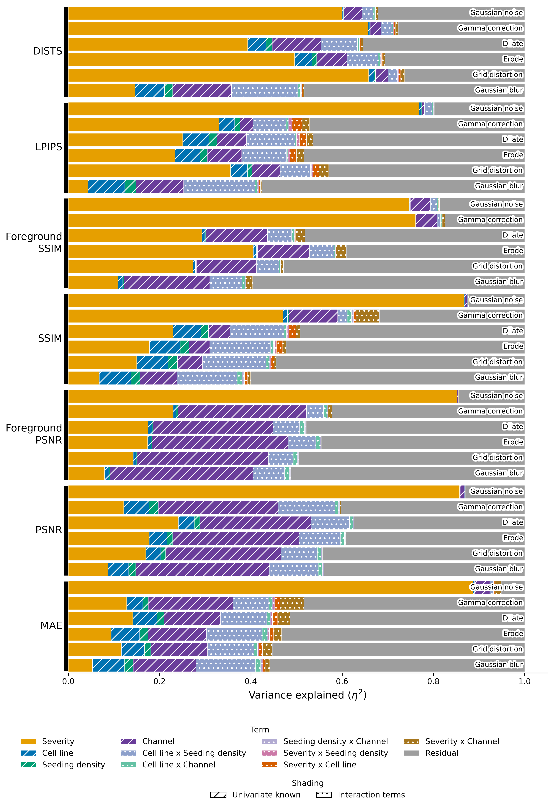
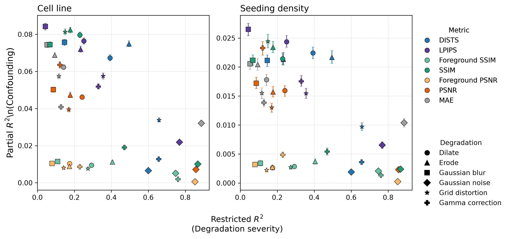
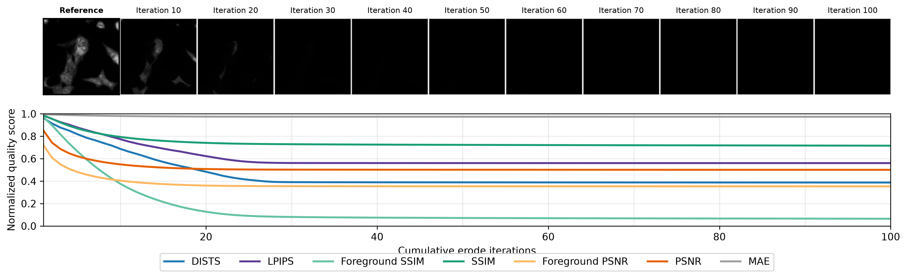
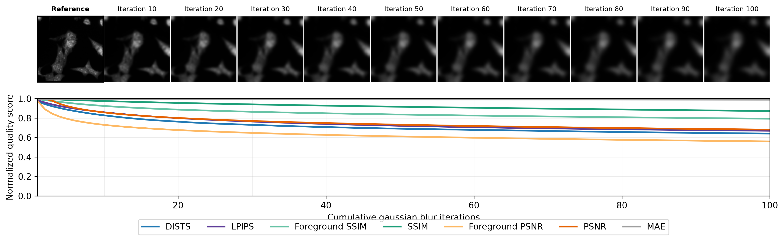

# Image quality assessment metrics vs. simulated image degradation

How much does an image quality score tell us about reconstruction quality, and how much does it reflect the cells being imaged?

## Goals

Here, we generate the PedCP90Sim dataset from [PedCP90](https://github.com/WayScience/pedcp90), using controlled degradations of Cell Painting images.
We then use PedCP90Sim to evaluate seven full-reference image quality assessment metrics, commonly used in optimization or selection of virtual staining models.
We examine two complementary properties of the metrics: **sensitivity to degradation** and **stability across biological and imaging contexts**.

This approach addresses the need to understand whether metrics developed for natural images remain sensitive and interpretable in microscopy applications, where changes in cell line, treatment, experimental procedure, and image acquisition may alter image content independently of reconstruction quality.
By jointly simulating image degradation and biologically driven distribution shifts in data, the analysis quantifies how metric scores reflect true losses in virtual-staining fidelity and gets confounded by the underlying content of the evaluated images.

## Dataset
We use a Cell Painting dataset [PedCP90](https://github.com/WayScience/pedcp90), consisting of 18 unperturbed pediatric cancer cell lines plated under 5 different levels of seeding density.

## Approach

### Image degrading transforms
We selected a suite of 6 families degrading image transforms to simulate artifacts from virtual staining models generating imperfect predictions:
- Gaussian noise (additive)
- Gaussian blur
- Erosion (grayscale morpholical operation)
- Dilation (grayscale morpholical operation)
- Gamma correction (dimming and brightening)
- Grid distortion
We apply these to the fluoresence Cell Painting channels of our dataset in 6 incremental levels of severity by tuning a single transformation parameter while leaving others fixed (see code for details).

This produces 36 degraded variant per image in our Cell Painting dataset.

### Image quality assessment metric evaluation of degraded variant against reference
After applying degradation transforms, we selected a collection of 5 full reference, image quality assessment metrics commonly used in microscopy and histology virtual staining work:
- Structural Similarity Index Measure (SSIM)
- Peak Signal-to-noise Ratio (PSNR)
- Deep Image Structure And Texture Similarity (DISTS)
- Learned Perceptual Image Patch Similarity (LPIPS)
- L1 (MAE)
And created foreground masked variants of SSIM and PSNR, inspired by the foreground aware training objective in Kalinin and colleagues (10.48550/arXiv.2507.05383):
- Foreground SSIM
- Foreground PSNR

Per every pair of degraded image variant and its original reference image, we evaluate our collection of 7 metrics, yielding 7 metric values per degraded varaint.

### Variance partitioning analysis
We then analyze with ANOVA variance partitioning and nested regression to what extents are variantions in metric values explained by the known degradation severity changes,
cell line indenitity of the images,
seeding densitiy label associated with the images,
and other known data inherent factors.

This allows us to quantify the absolute and relative metric sensitivity to degradation and susceptibility to confounding by data inherent variations.

## Main findings

### Same degradation, different scores across biology and imaging context

Metric scores depend on cell line, seeding density, and fluorescence channel as well as degradation severity.
Consequently, a score difference between biological conditions cannot automatically be interpreted as a difference in reconstruction quality.
The variance analysis also considers severity-by-context interactions, which distinguish context-dependent responses from simple shifts in baseline scores.

> Metric major visualization showing detailed metric variance decomposition results attributing metric variation to degradation, biology and technical variations. Every row is the result of a metric-degradation combination.

The [radar summary by degradation](results/variance_partition_analysis/plots/anova_radar_by_degradation.png) provides a degradation-major alternative visualization to highlight common strengths and weakness of metrics.

### Sensitivity (to degradation) and stability across biology are different strengths

> This scatter plot visualizes the two properties: **sensitivity to degradation** (x-axis, higher is more sensitive) and **stability across biological and imaging contexts**(y-axis, lower is more stable) of all metrics against all degradations.

There is no single metric that is optimal for all degradation types investigated here, but the analysis indicates that DISTS offers a favorable balance between sensitivity and stability across degradations.
Foreground SSIM and PSNR reduce the seeding-density burden relative to whole-image counterparts, suggesting that restricting evaluation to cellular regions can improve comparability when the amount of background changes.

### Scores can flatten despite continued degradation

The cumulative-degradation experiment highlights early flattening of metric responses, particularly for blur and erosion.
Once a response flattens, additional transformations may produce very little score change and cease to alert researchers of the worsening abnormality.
Viewing the trajectory alongside image snapshots helps distinguish loss of metric sensitivity from an image that has itself stopped changing appreciably.

> Against degradations such as erosion that lessens objects (cell) gradually, where information is systemically lost, metrics tend to capture continued degradation and flatten only when the image is essentially blank.

> Against degradations such as blur, high frequency information such as texture gets lost but low frequency signal such as object location stays intact, metrics flatten quite early on and cease to respond to continued blurring.
