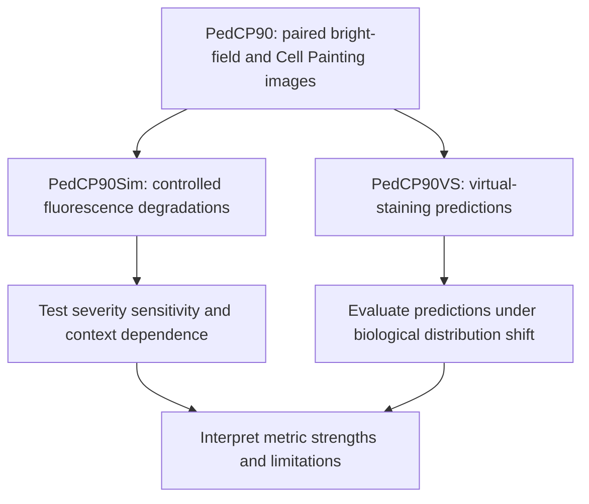
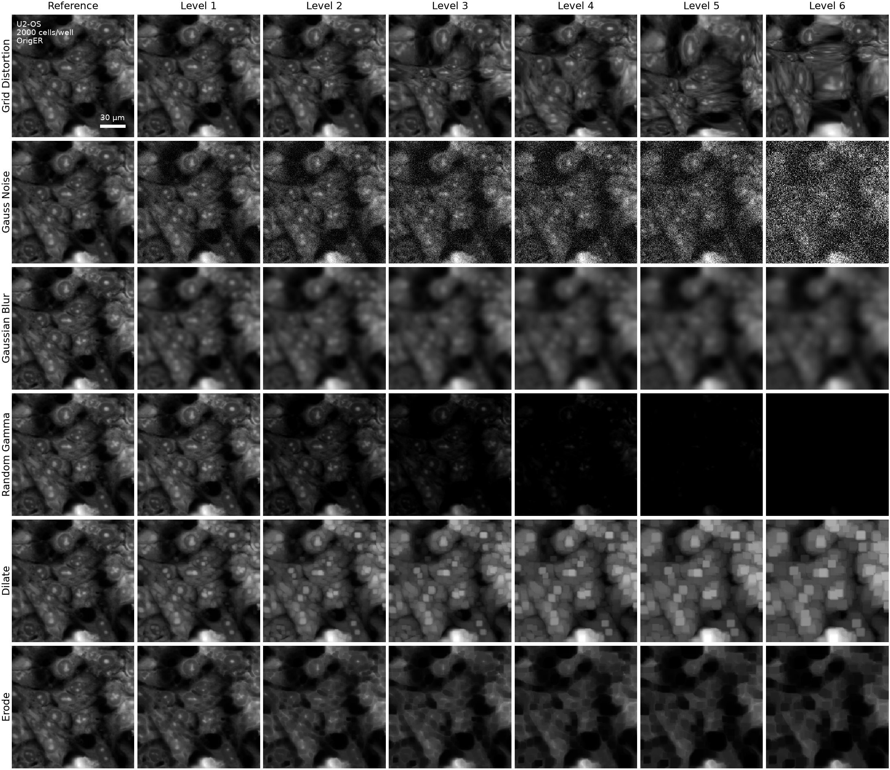
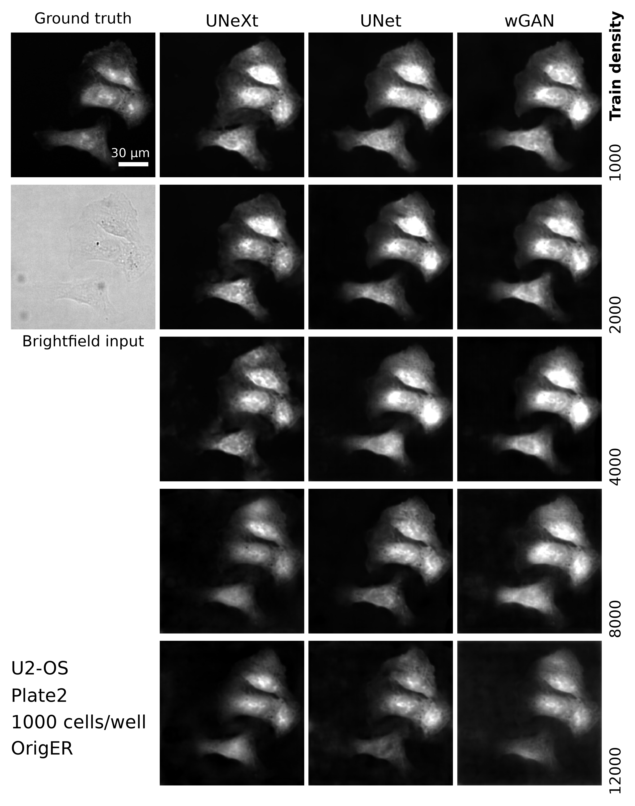

# What do image quality metrics tell us about virtual staining?

This repository contains the analyses for [On doubting image quality assessment metrics for microscopy virtual staining](https://www.biorxiv.org/content/10.64898/2026.08.31.748410v1.full).

We investigate what full-reference image quality scores reveal — and may miss — when evaluating label-free virtual staining across biological and technical variation. 
Two complementary datasets connect controlled image errors with realistic model predictions.

## Why biological context matters

Virtual-staining models are often applied across changes in cell line, cell density, and imaging conditions. 
Many commonly used metrics were developed for natural images and are not guaranteed to be content invariant: the same kind of reconstruction error may receive different scores when the underlying biological image content changes.

We ask three questions:

1. **Do metric scores track degradation severity consistently across biological contexts?**
2. **Do scores remain responsive as image quality continues to deteriorate?**
3. **What do scores capture or obscure about actual virtual-staining predictions on unseen biological conditions?**

## One source dataset, two complementary evaluations

**[PedCP90](https://github.com/WayScience/pedcp90)** is a curated subset of the pilot imaging data generated for the **Pediatric Cancer Cell Morphology Atlas (PCCMA)**, a broader initiative to systematically characterize pediatric cancer cell morphology through high-content Cell Painting microscopy. 
PCCMA spans a substantially larger collection of cell lines and experimental conditions, with future expansions planned to incorporate perturbational profiling, enabling the study of morphological diversity and cellular responses to perturbations across pediatric cancers.

PedCP90 focuses on 90 combinations of 18 cell lines and five seeding densities, with paired bright-field and five standard Cell Painting fluorescence channels. 
All images were drawn exclusively from the 24-hour time point of the two batch 1 plates, providing a consistent imaging subset for evaluating virtual staining and image-quality assessment metrics. 
For the broader atlas and profiling pipeline, see the [PCCMA profiling repository](https://github.com/WayScience/pediatric_cancer_atlas_profiling).

Both evaluations use **DISTS, LPIPS, MAE, PSNR, SSIM, foreground PSNR, and foreground SSIM**. 
This shared panel connects controlled stress tests to real predictions; the metrics do not measure interchangeable aspects of error.

### PedCP90Sim · Controlled image degradation

We apply **six degradation families at six severity levels**, producing 36 variants per fluorescence reference patch: grid distortion, Gaussian noise, Gaussian blur, gamma adjustment, dilation, and erosion. 
Comparing each variant with its reference isolates known image errors without introducing differences between trained models.

*How to read this montage:* Each row shows one degradation family; columns show the reference and six configured severity levels. 
The U2-OS ER example uses the reference intensity range for every panel, preserving visible intensity differences. 
Levels are specific to each transform, not equivalent amounts of error across rows.

[Generate the montage](1.image_degradation_simulation/1.11.degradation_montage.ipynb) · [Methods and detailed findings](1.image_degradation_simulation/README.md)

The dataset-wide analysis examines metric variation with severity, cell line, seeding density, and channel. 
A **separate cumulative-degradation experiment** repeatedly applies small transformations to one selected patch, pairing score trajectories with image snapshots to examine response flattening; it is not the discrete-level experiment illustrated above.

### PedCP90VS · Real virtual-staining predictions

We train models on paired bright-field and fluorescence images, then compare predictions with measured fluorescence under evaluation conditions that include unseen cell lines and/or plating conditions. 
These predictions complement the controlled degradations with realistic combinations of intensity mismatch, texture loss, artifacts, and spatial errors.

*How to read this montage:* The left column provides measured fluorescence, bright-field input, and evaluation context. 
Prediction columns correspond to UNeXt, UNet, and wGAN; rows correspond to training seeding densities of 1,000–12,000 cells/well. 
The example is U2-OS, plate 2, evaluated at 1,000 cells/well. 
Fluorescence panels share the reference intensity range; bright-field is scaled independently.

[Generate the montage](3.model_eval/3.2.model_inference_montage.ipynb) · [Explore model evaluation](3.model_eval/)

## What the analyses indicate so far

- **Biological context affects scores.** Cell line, seeding density, and channel contribute to score variation alongside degradation severity. 
DISTS shows a favorable sensitivity–stability balance in the controlled analyses, and foreground masking can reduce seeding-density effects; neither removes all content dependence.
- **Sensitivity depends on the error type.** Scores can flatten while images continue to deteriorate, particularly under progressive blur. 
Image sequences are essential for interpreting score trajectories.
- **A similar score need not imply a similar error.** Initial prediction evaluations motivate inspecting structural and textural differences alongside coarse generalization patterns. 
Their quantitative interpretation remains in progress.

The practical message is to interpret scores **alongside biological context and representative images**, not as complete descriptions of prediction fidelity. 
Detailed figures, methods, and qualifications belong with the individual analyses.

## Navigating the analyses

| Stage | Entry point | Contents |
| --- | --- | --- |
| Controlled degradation | [Analysis README](1.image_degradation_simulation/README.md) | Data preparation and metric evaluation; variance partitioning and biological-context associations; cumulative response experiments |
| Model training | [Training workflow](2.train_models/) | Data splits, model training, and local/array launch scripts |
| Model evaluation | [Evaluation workflow](3.model_eval/) | Inference, metric evaluation, variance partitioning, concordance, and empirical dynamic range |
| Dataset previews | [Degradation montage](1.image_degradation_simulation/1.11.degradation_montage.ipynb) and [prediction montage](3.model_eval/3.2.model_inference_montage.ipynb) | Reproducible sample selection and annotated exports of saved image data |

For controlled degradation, notebooks **1.0–1.4** cover preparation and metric evaluation, **1.5–1.8** examine severity and context associations, **1.9–1.10** explore cumulative responses, and **1.11** previews the saved degradation dataset. 
The montage notebooks read existing artifacts rather than regenerate images or rerun model training; each documents its prerequisites and editable sampling/display settings.

## Scope and next steps

This study characterizes limitations of current image quality metrics in terms of sensitivity to degradation and their interpretation in context of microscopy image reconstruction. 
We do **not** establish, yet, that using these metrics for virtual staining model selection or training causes incorrect biological conclusions in direct applications such as substituting virtual staining for measured Cell Painting in drug screens. 
Nor is this study any form of benchmark comparing the performance published virtual-staining architectures.

Next steps are to complete the prediction analyses and test whether metric-based virtual staining model selection yields predictions that preserves biologically relevant feature space structure, and to what extent uexperimental findings across unseen perturbations remain valid.
